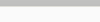

# Remaining LeanUI pixel parity

Follow-up to #1822, based on merge commit
`2c36e4608eef19eb2d5c23ae368c36cbe60f3ead`.

The verified pre-merge measurement from
[run 43802006749](https://github.com/Th0rgal/orb/actions/runs/43802006749)
has 36 pairs, 0 measurement errors, 2 variants under 1% mismatch, mean
mismatch 5.01%, mean above-tolerance mismatch 2.70%, and mean SSIM 0.9521.
The worst mismatch is `07_search_dialog`, light, 2x: 14.94%.
These are baseline numbers, not evidence of a follow-up improvement.

## Work queue

### Search-dialog border correction

The renderer used `pal.border` directly. `SearchDialog.css` instead mixes
8% foreground into that stroke. Applying the same mix improves raw mismatch:

| variant | before | after |
|---|---:|---:|
| dark 1x | 11.1062% | 10.8981% |
| dark 2x | 11.2641% | 11.0534% |
| light 1x | 14.6969% | 14.4888% |
| light 2x | 14.9429% | 14.7322% |

All other 32 candidate images are unchanged in the local before/after run;
no variant regressed. The full documented comparison reports 2/36 under 1%,
mean 4.99%, worst light 2x search 14.73%. These captures use the pinned private
fonts and the merged-head artifact references. The host's libc++ link selection
required explicitly linking the toolchain library directory after compilation;
CI remains the clean build evidence.

Border crops (light 1x, x=470..570, y=68..90):

| reference | before | after |
|---|---|---|
|  |  |  |

Search remains above 1%; blur and typography differences remain renderer work,
not a demonstrated external reference blocker. This correction alone does not
satisfy the new-under-1% merge condition.

- Search dialog: inspect backdrop blur/compositing and sidebar differences
  first; all four variants exceed 11% mismatch, while above-tolerance
  mismatch is below 1.8%.
- Shared sidebar: inspect populated card typography and geometry across
  control, mission, machines, new-mission, and toast screens.
- Mission transcript and split diff: align text, pane geometry, and composer.
- Toasts, settings, and machines: inspect remaining screen-specific regions.
- Re-run the complete 36-variant measurement after rendering changes and
  record improvements and regressions before accepting them.

The `fix/leanui-parity-remaining` branch runs the existing pinned parity
workflow. Keep reference hashes, thresholds, masks, and comparison code
unchanged. U3 remains incomplete until the documented parity criteria pass.
U2 acceptance and the roadmap row are owned by the parent after merged-head
run [43807502974](https://github.com/Th0rgal/orb/actions/runs/43807502974)
passes; this follow-up does not change the roadmap.
