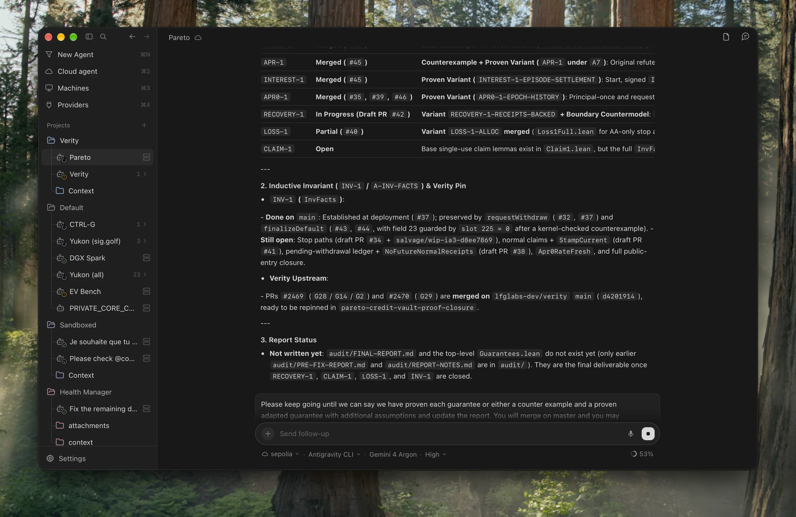

# Orb Desktop

Desktop client for **Orb** (SolidJS + native WebKit shell + Lean 4 `orb-locald` daemon): projects and their synchronized `@context` files, running missions with live transcripts, local and remote machines (the `orb-node` fleet plus shared SSH hosts), providers (CLIProxyAPI-owned OAuth subscriptions and API keys), and a unified **New Agent** / **Cloud Agent** composer. Connect to your Core backend in **Settings → Client → Backend** (dashboard password); the URL and JWT are persisted locally in `~/.orb/connection.json` (`0600`).



```bash
pnpm install
pnpm desktop:dev      # <100ms HMR dev loop (Vite on 127.0.0.1:1430 + native shell + orb-locald)
pnpm desktop:ui       # ~10s UI-only update: rebuild dist/ and sync into /Applications/Orb.app (skips Lean/Swift)
pnpm desktop:bundle   # stage standalone macos_shell/build/Orb.app bundle
pnpm desktop:install  # full incremental Lean + Swift + UI build synced into /Applications/Orb.app
```

You can also attach an already-installed `/Applications/Orb.app` directly to a running Vite dev server (`pnpm dev`):

```bash
ORB_DEV_URL=http://127.0.0.1:1430/ /Applications/Orb.app/Contents/MacOS/orb
```

Shortcuts (`src/keyboardShortcuts.ts` & `docs/KEYBOARD_SHORTCUTS.md`):
- `⌘1` / `⌘N` new agent · `⌘I` inbox · `⌘2` cloud agent · `⌘3` machines · `⌘4` inference · `⌘5` projects
- `⌘B` sidebar · `⌘J` files panel · `⌘⇧B` file tree · `⌘K` (or `⌘⇧J`) `/btw` side agent · `⌘P` file palette
- `⌘[` / `⌘]` history · `⌘F` find in pane · `⌘⇧F` search all conversations · `⌘\` focus/expand · `⌘⇧E` split · `⌘/` markdown source/preview · `⌘,` settings · `Esc` back

Start a draft with `/goal <objective>` for autonomous multi-turn goal execution, `/plan <task>` for native interactive planning (Claude Code and Codex), or `/btw <question>` to ask a side agent in the same workspace without interrupting the main run. Remote launches follow the
`remote_launch` capability advertised by `GET /api/remote-nodes`; harnesses the
server has not confirmed for a node are refused before any request is sent.

Cron forms share the same schedule, instruction, skills, repeat, advanced fields,
validation and discard behavior. Drafts are kept in session storage, scoped to
the backend and project/job, across navigation and dialog dismissal; Save or
Discard clears them. Browser close/reload also prompts while edits are pending.
Continuity means injecting the job's own previous output (`context_from: self`),
not creating or resuming a native session.

The Hermes REST whitelist at production revision `882881de` does not expose all
of its storage fields. `../patches/hermes/orb-cron-api-fields.patch` supplies that
API parity. Apply it as part of a separately managed Hermes release; Orb warns
when an older API drops an override. A successful creation with dropped overrides
still opens the created cron and reports the missing fields, avoiding a second
creation on retry. No patch is applied to a live service by the tests.

The single-package `pnpm-workspace.yaml` isolates Orb from parent workspaces and
allows only esbuild's install script. `packageManager` pins pnpm 10.17.1, whose
configuration uses `onlyBuiltDependencies`.

Local verification (no live backend required):

```sh
pnpm install --frozen-lockfile
pnpm build
pnpm test
pnpm exec playwright install chromium
pnpm test:browser
```

Browser tests serve the actual components in a fixture harness and intercept all
API calls. They cover creation, cached root-folder refresh, revealing the created
cron, keyboard menus, tab/unmount draft retention, cursors, compact schedule layout,
and light/dark screenshots. The Hermes job records are captured from real storage
functions; see `tests/fixtures/README.md` for provenance and regeneration.

Local voice input (macOS on Apple Silicon): the composer's microphone records in
the webview and transcribes on-device with a pinned MLX build of Cohere
Transcribe, inserting editable text without sending. Install the isolated
runtime with `voice/install.sh --download-model --check`; architecture, paths,
verification commands and the remaining Mac checklist are in `voice/README.md`.
